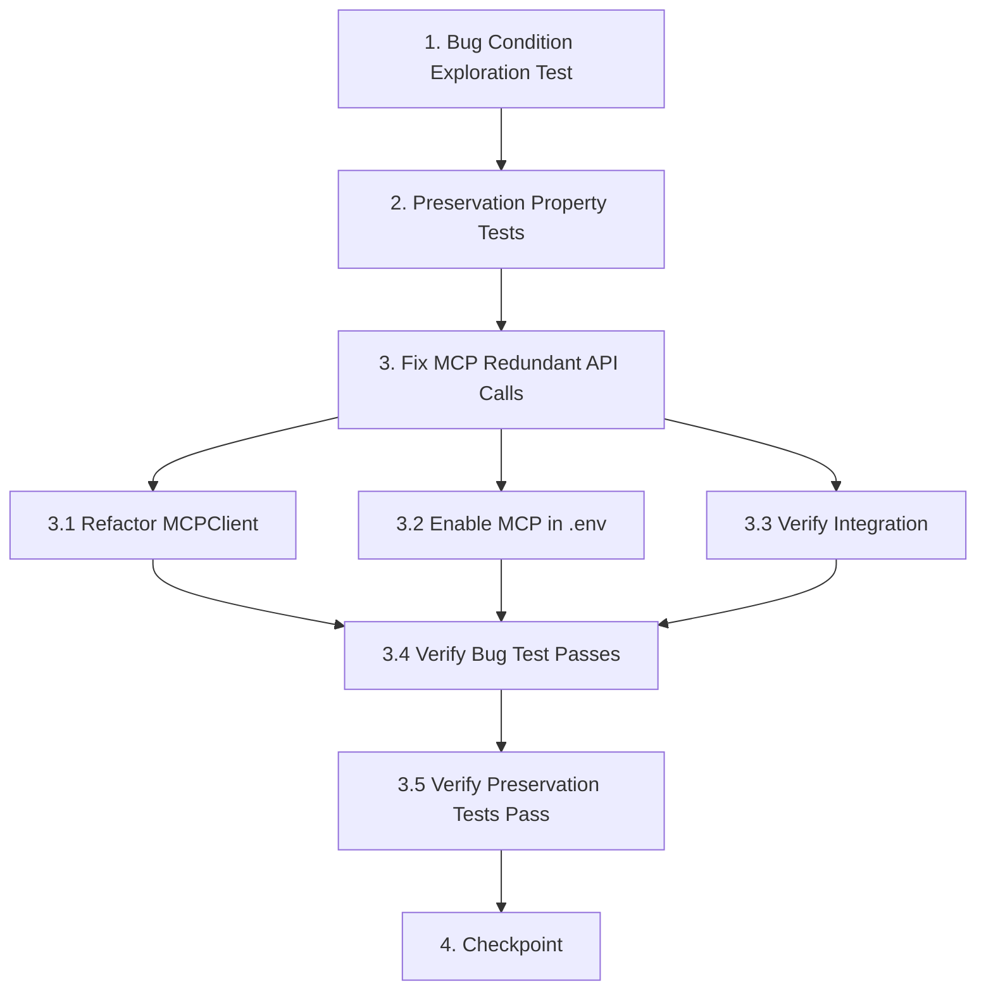

# Implementation Plan

## Overview

This task plan implements the bugfix for MCP redundant API calls by refactoring MCPClient to delegate all market data fetching to the MarketDataFetcher singleton. The workflow follows exploratory bugfix methodology: first write tests to demonstrate the bug exists (exploration), then write tests to capture behavior that must be preserved, then implement the fix, and finally verify both fix and preservation.

## Task Dependency Graph



```json
{
  "waves": [
    {
      "name": "Wave 1: Test Preparation",
      "tasks": ["1", "2"]
    },
    {
      "name": "Wave 2: Implementation", 
      "tasks": ["3.1", "3.2", "3.3"]
    },
    {
      "name": "Wave 3: Verification",
      "tasks": ["3.4", "3.5"]
    },
    {
      "name": "Wave 4: Final Checkpoint",
      "tasks": ["4"]
    }
  ]
}
```

**Dependencies:**
- Task 2 depends on Task 1 (need to understand bug before defining preservation scope)
- Task 3.1, 3.2, 3.3 are parallel and can be done in any order
- Task 3.4 requires 3.1, 3.2, 3.3 to be complete
- Task 3.5 requires 3.4 to be complete
- Task 4 requires all previous tasks to be complete

## Tasks

- [x] 1. Write bug condition exploration test
  - **Property 1: Bug Condition** - MCP Makes Redundant Yahoo Finance Calls
  - **CRITICAL**: This test MUST FAIL on unfixed code - failure confirms the bug exists
  - **DO NOT attempt to fix the test or the code when it fails**
  - **NOTE**: This test encodes the expected behavior - it will validate the fix when it passes after implementation
  - **GOAL**: Surface counterexamples that demonstrate redundant API calls exist
  - **Scoped PBT Approach**: Focus on the concrete failing case - MCPClient methods using direct `yf.Ticker()` calls
  - Test that MCPClient imports and uses `get_market_data_fetcher()` singleton
  - Test that MCPClient methods do NOT contain direct `yf.Ticker()` calls in their implementation
  - Test that calling `mcp_client.get_market_data("saas")` delegates to `MarketDataFetcher` methods
  - Test that multiple MCPClient method calls share the same fetcher singleton instance
  - The test assertions should verify:
    - MCPClient has imported `from src.data.market_data_fetcher import get_market_data_fetcher`
    - MCPClient.__init__ initializes `self.fetcher = get_market_data_fetcher()`
    - Methods `get_market_data`, `get_financial_benchmarks`, `get_competitor_analysis`, `analyze_market_trends` call `self.fetcher` methods
    - No direct `yf.Ticker()` calls exist in any MCPClient method implementations
  - Run test on UNFIXED code (src/mcp/mcp_client.py in current state)
  - **EXPECTED OUTCOME**: Test FAILS (this is correct - it proves the bug exists)
  - Document counterexamples found:
    - MCPClient methods contain direct `yf.Ticker()` calls
    - No import of `get_market_data_fetcher` found in mcp_client.py
    - MCPClient doesn't store fetcher singleton reference
    - API call counting shows duplicate fetches for same ticker symbol
  - Mark task complete when test is written, run, and failure is documented
  - _Requirements: 1.1, 1.2, 1.4_

- [x] 2. Write preservation property tests (BEFORE implementing fix)
  - **Property 2: Preservation** - RAG Engine Direct Access Preserved
  - **IMPORTANT**: Follow observation-first methodology
  - Observe behavior on UNFIXED code for non-MCP operations:
    - Set `MCP_ENABLED=false` in test environment
    - Call `rag_engine.generate_market_analysis_with_rag()` with test industry data
    - Observe the market analysis output structure and content
    - Call `MarketDataFetcher.get_industry_overview()` directly
    - Observe the exact return format and data fields
    - Generate a complete business plan with document export (PDF/DOCX)
    - Observe the document structure and content sections
  - Write property-based tests capturing observed behavior patterns:
    - **Property**: For all business data inputs where MCP is disabled, RAG engine produces market analysis with structure {industry_overview, competitors, growth_metrics, market_size}
    - **Property**: For all industry inputs, MarketDataFetcher.get_industry_overview() returns data structure unchanged
    - **Property**: For all business plan generations where MCP_ENABLED=false, document content sections remain identical
    - **Property**: For all LLM content generation calls, output quality and structure remain unchanged when MCP is bypassed
  - Property-based testing generates many test cases for stronger guarantees
  - Run tests on UNFIXED code
  - **EXPECTED OUTCOME**: Tests PASS (this confirms baseline behavior to preserve)
  - Mark task complete when tests are written, run, and passing on unfixed code
  - _Requirements: 3.1, 3.2, 3.3, 3.4, 3.5, 3.6_

- [x] 3. Fix for MCP redundant API calls

  - [x] 3.1 Refactor MCPClient to use MarketDataFetcher singleton
    - Add import statement to top of `src/mcp/mcp_client.py`:
      ```python
      from src.data.market_data_fetcher import get_market_data_fetcher
      ```
    - Update `MCPClient.__init__` to store fetcher singleton reference:
      ```python
      def __init__(self):
          self.fetcher = get_market_data_fetcher()
          self.enabled = True
          # ... rest of initialization
      ```
    - Refactor `get_market_data()` method to delegate to `self.fetcher`:
      - Replace direct `yf.Ticker()` calls with `self.fetcher.get_industry_tickers(industry)`
      - Use `self.fetcher.get_company_data(ticker)` for company information
      - Use `self.fetcher.calculate_growth_rate(tickers)` for growth calculations
      - Format and return data in expected MCP structure
    - Refactor `get_financial_benchmarks()` method:
      - Use `self.fetcher.get_industry_tickers(industry)` to get ticker list
      - Use `self.fetcher.get_competitors_data(tickers)` to fetch competitor data
      - Calculate averages from competitor metrics
      - Return formatted benchmarks
    - Refactor `get_competitor_analysis()` method:
      - Use `self.fetcher.get_industry_overview(industry)` for comprehensive data
      - Extract and reformat competitor information
      - Add business_type-specific context
      - Return formatted competitor analysis
    - Refactor `analyze_market_trends()` method:
      - Use `self.fetcher.get_industry_tickers(industry)` to get tickers
      - Use `self.fetcher.calculate_growth_rate(tickers)` for growth metrics
      - Use `self.fetcher.estimate_market_size(tickers)` for market sizing
      - Format into trends analysis with timeframe context
      - Return formatted market trends
    - Remove redundant `_get_industry_tickers()` method (now provided by fetcher)
    - Remove redundant `_estimate_industry_growth()` method (now provided by fetcher)
    - Update `enhance_business_plan()` method with clear logging:
      ```python
      print(f"📊 MCP: Using MarketDataFetcher singleton for data")
      print(f"📊 Data Flow: MCP → MarketDataFetcher → Yahoo Finance")
      ```
    - _Bug_Condition: isBugCondition(method_execution) where method_execution.code_contains('yf.Ticker(') AND NOT method_execution.code_contains('get_market_data_fetcher()')_
    - _Expected_Behavior: All MCPClient methods delegate to MarketDataFetcher singleton, eliminating redundant yf.Ticker() calls_
    - _Preservation: RAG engine continues to call MarketDataFetcher directly when MCP is disabled, document generation unchanged, MarketDataFetcher return formats unchanged_
    - _Requirements: 2.1, 2.2, 2.4, 2.5_

  - [x] 3.2 Enable MCP integration in environment configuration
    - Update `.env` file to set `MCP_ENABLED=true`
    - Verify that `src/business_plan_generator.py` properly reads this flag
    - Add logging to trace when MCP enhancement is active vs bypassed
    - _Requirements: 2.1, 2.3_

  - [x] 3.3 Verify MCPClient integration in business plan generator
    - Review `src/business_plan_generator.py` for proper MCPClient usage
    - Ensure conditional logic correctly applies MCP enhancement when enabled
    - Add traceability logging showing data flow through MCP → MarketDataFetcher
    - Verify backward compatibility when MCP_ENABLED=false
    - _Requirements: 2.3, 2.6, 3.6_

  - [x] 3.4 Verify bug condition exploration test now passes
    - **Property 1: Expected Behavior** - MCP Delegates to MarketDataFetcher
    - **IMPORTANT**: Re-run the SAME test from task 1 - do NOT write a new test
    - The test from task 1 encodes the expected behavior
    - When this test passes, it confirms the expected behavior is satisfied
    - Run bug condition exploration test from step 1
    - Verify test assertions now pass:
      - MCPClient imports `get_market_data_fetcher` ✓
      - MCPClient stores singleton in `self.fetcher` ✓
      - All market data methods delegate to `self.fetcher` ✓
      - No direct `yf.Ticker()` calls remain in MCPClient ✓
    - **EXPECTED OUTCOME**: Test PASSES (confirms bug is fixed)
    - _Requirements: 2.2, 2.4_

  - [x] 3.5 Verify preservation tests still pass
    - **Property 2: Preservation** - RAG Engine Direct Access
    - **IMPORTANT**: Re-run the SAME tests from task 2 - do NOT write new tests
    - Run preservation property tests from step 2
    - Verify all preservation properties still hold:
      - RAG engine with MCP_ENABLED=false produces identical output ✓
      - MarketDataFetcher.get_industry_overview() returns unchanged structure ✓
      - Document generation produces identical content ✓
      - LLM integration continues functioning correctly ✓
    - **EXPECTED OUTCOME**: Tests PASS (confirms no regressions)
    - Confirm all tests still pass after fix (no regressions)

- [-] 4. Checkpoint - Ensure all tests pass
  - Run complete test suite to verify:
    - Bug condition exploration test passes (MCPClient delegates to MarketDataFetcher)
    - Preservation tests pass (RAG engine and document generation unchanged)
    - Unit tests pass for MCPClient refactored methods
    - Integration tests pass for full business plan generation with MCP_ENABLED=true
    - No direct `yf.Ticker()` calls remain in MCPClient code
  - Verify logging shows clear data flow: "MCP → MarketDataFetcher → Yahoo Finance"
  - Test end-to-end business plan generation with real market data
  - Confirm backward compatibility with MCP_ENABLED=false
  - Ensure Streamlit Cloud deployment compatibility maintained
  - Ask user if questions arise or if any tests reveal unexpected behavior


## Notes

### Property-Based Testing Approach

This bugfix uses property-based tests for both bug condition exploration and preservation:

- **Bug Condition (Property 1)**: Tests that MCPClient delegates to MarketDataFetcher for all market data operations, with no direct `yf.Ticker()` calls
- **Preservation (Property 2)**: Tests that RAG engine and document generation continue to work identically when MCP is disabled

### Testing Methodology

The exploration test (Task 1) is designed to **FAIL on unfixed code**. This failure is expected and confirms the bug exists. Do not attempt to fix the test - the test encodes the correct expected behavior that will be satisfied after implementing the fix in Task 3.

The preservation tests (Task 2) are designed to **PASS on unfixed code**. This establishes the baseline behavior that must be preserved. These same tests should continue passing after the fix to prove no regressions occurred.

### Key Files Modified

- `src/mcp/mcp_client.py` - Main refactoring to use MarketDataFetcher singleton
- `.env` - Enable MCP integration with `MCP_ENABLED=true`
- `src/business_plan_generator.py` - Verification of proper MCP integration

### Deployment Considerations

- All changes maintain Streamlit Cloud compatibility (no external MCP server processes required)
- Backward compatibility preserved when `MCP_ENABLED=false`
- No breaking changes to document generation or RAG engine functionality
- Data flow becomes transparent: MCP → MarketDataFetcher → Yahoo Finance
